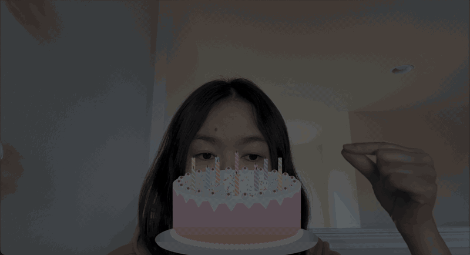

# 🎂 Birthday cake candle

A birthday cake for your webcam. Snap to light a flame on your fingertip, touch it to the wicks to light the candles, then blow them out and make a wish.



**Try it:** <https://sophiamyang.github.io/birthday-cake-candle/> (Chrome or Edge on a laptop, allow the camera and microphone)

Every flame is a real light. A depth model runs on your GPU on every camera frame, so the candlelight wraps around your face, glows under your chin and casts soft shadows on the wall behind you, all live in the browser.

## How to play

1. **Light your finger.** Raise your index finger, then snap, or tap your thumb and index finger together and open them, like flicking a lighter.
2. **Light the candles.** Hold the flame on a wick until it catches. Sweep across the cake to light them one after another. Your face gets brighter with every candle.
3. **Put your finger out.** Make a fist, or give your hand a quick shake.
4. **Blow out the candles.** Blow toward the screen. The candles in front of your mouth get the most wind, so turn your head to reach the rest. When the last one goes out, the room goes dark, confetti bursts and "Make a wish ✨" appears.

No microphone, or blowing doesn't register? Hold **`B`** to blow instead.

## Controls

| Input | Action |
|---|---|
| Snap, or a quick thumb-and-index tap | Light the finger flame |
| Hold the flame on a wick | Light that candle. Where candles overlap, aim higher for the one behind. |
| Fist, or a quick shake | Put the finger flame out |
| Blow at the screen, or hold `B` | Blow the candles (and the finger flame) out |
| `F` | Toggle the finger flame |
| `L` / **light all** | Relight every candle |
| `+` / `-`, or the candle slider | Number of candles |
| `K` / 🎂 | Show or hide the cake |
| `R` / **● REC mode** | Recording mode: hides all buttons, text and the cursor for a clean screen recording. `R` or `Esc` to exit. |
| `O` / ⓘ | Stats overlay: frame rate, depth model, hand tracking, gesture state |
| `V` | Cycle views: lit, depth, normals, light only |
| `S` | Toggle shadows |
| `G` | Save the last 20 s of hand landmarks as JSON (positions only, no images), for tuning gestures |

### Recording a clip

Press `R` (or open the page with `?record`) to hide everything but the picture, then record the browser window, for example with `⌘⇧5` on a Mac. Full screen (`⌃⌘F`) gives the cleanest result. The confetti and "Make a wish" caption stay in the shot.

## Requirements

- **A browser with WebGPU:** Chrome or Edge 113+ on macOS, Windows or ChromeOS. Safari 26+ and Firefox may work but haven't been tested.
- **A GPU.** The depth model runs on it every frame. Apple Silicon Macs are recommended; weaker GPUs give a lower frame rate.
- **About 25 MB of downloads on first load:** the depth model (13 MB, cached afterwards), the MediaPipe hand model (8 MB) and face model (4 MB).

## Run it locally

```bash
npm install
npm run dev
```

Then open <http://localhost:5173>. Other scripts: `npm test` (unit tests, no browser or GPU needed), `npm run build`, `npm run preview`.

Every push to `main` deploys the site to GitHub Pages through `.github/workflows/pages.yml`. To set it up on a fork, choose **Settings → Pages → Source: GitHub Actions**.

## How it works

```
webcam ──► MediaPipe hand tracker ──► fingertip position, snap / pinch / fist / shake
   │       MediaPipe face tracker ──► where your mouth is, and whether it's shaped to blow
   │       microphone             ──► blow strength
   │
   └──► GPU compute, every camera frame (TypeGPU):
   │        DepthART depth model ──► stable depth range ──► temporal smoothing
   │        ──► surface slopes and ambient occlusion ──► depth at the fingertip
   │
   └──► one full-screen render pass (WGSL):
            darkened room + one point light per flame, with soft falloff,
            wrap lighting, a little specular and ray-marched soft shadows
            ──► cake composited by depth, so a hand in front of it passes in front
            ──► procedural flames, smoke, tone map
```

- **Depth on the GPU.** DepthART runs as about 250 TypeGPU compute dispatches on each camera frame, in the same GPU queue as the lighting, with nothing read back to the CPU. Depth stays in step with the video, so a moving hand doesn't leave a lagging ghost.
- **Relative depth, gentle light.** The depth is relative, not metric, so lights fall off softly instead of by the inverse square law, and depth errors don't cause brightness jumps.
- **The cake** is drawn procedurally on a canvas, with its own depth and normals, and lit by its candles and your finger. Each lit candle is a point light.
- **Blow detection** looks for sustained, noise-like, bass-heavy sound: breath on a laptop mic. Voices, typing and footsteps fail one of those tests. When the camera sees a blowing mouth (rounded lips or puffed cheeks), the test relaxes. The wind is aimed: candles in front of your mouth get more of it.
- **Gestures** come from MediaPipe's 3D hand landmarks: thumb-to-fingertip distances for pinch and snap, fingers folded into the palm for a fist, fast side-to-side reversals for a shake.

Code map:

| Path | What's in it |
|---|---|
| `src/main.ts` | Frame loop, input, UI |
| `src/renderer.ts`, `src/shader.ts` | WebGPU setup and the lighting shader |
| `src/depthart/` | Depth model and depth filtering (vendored from TypeGPU; `pipeline.ts` is the glue) |
| `src/hands.ts`, `src/gestures.ts` | Hand tracking and gesture detection |
| `src/face.ts`, `src/blow.ts` | Mouth tracking and the microphone blow detector |
| `src/cake.ts`, `src/cakeMode.ts`, `src/confetti.ts` | Cake drawing, candle lighting and blowing, the wish moment |
| `src/synthetic.ts` | A camera-free test scene |

## URL options

| Option | Default | Effect |
|---|---|---|
| `candles=N` | `12` | Number of candles (1–64) |
| `lit=all` | | Start with every candle lit |
| `cake=0` | | Start with just the finger flame |
| `record` | | Start in recording mode |
| `nomic` | | Don't ask for the microphone |
| `model=small\|base\|large` | `small` | Depth model size: 13, 24 or 68 MB. Bigger is sharper and slower. |
| `intensity` | `3` | Finger flame brightness |
| `candlePower` | `0.3` | Brightness of each candle |
| `radius` | `0.6` | How far light reaches, in frame heights |
| `ambient` | `0.35` | How much of the room stays visible (lower is darker) |
| `exposure` | `1` | Overall exposure |
| `relief`, `specular`, `shadow`, `occlusion` | `0.85`, `0.22`, `0.7`, `0.55` | Surface shape, highlight, shadow and crease strength |
| `shadows=0` | | Turn shadows off |
| `flame` | `0.085` | Finger flame height, as a fraction of screen height |
| `cakeDepth` | `0.87` | How near the cake sits (1 = nearest). Raise it if your hand disappears behind the cake too easily. |
| `overlay=0`, `view=0..3` | | Start with the overlay hidden, or in a debug view |
| `depth=off` | | Skip the depth model |

For development without a camera: `synthetic` uses a procedural scene. Add `script` to drive a scripted hand through the real gesture detector (events are logged to `window.__ffLog`), with `simfps`, `until`, `tip=x,y`, `finger=off`, `depth=model` and `demo=blow` for tests and screenshots. `cpuUpload` copies camera frames through a canvas, for software GPUs.

## Known limits

- **Depth from one camera is approximate.** Fine detail such as a nose barely casts a shadow, and shadows only come from surfaces the camera can see.
- **Your hand is lit smoothly, not in detail.** Depth on thin fingers is rough, so the hand holding the flame doesn't shadow itself and is lit as one smooth surface.
- **Gestures are heuristics.** A loose fist may not register, and fast side-to-side waving counts as a shake. Snaps are hardest at low frame rates; the thumb-and-index tap is the most reliable. After any gesture there's a 0.8 s pause before the next one counts.
- **Blowing is a heuristic too.** Fans, wind or rustling near the mic can count as a blow. Headsets with strong noise cancellation can hide breath completely; use `B` there.
- **The cake is a 2.5D sprite** at the bottom centre of the frame. It doesn't turn with the camera.
- **Many candles** (30+) can wash the face out to white. Lower `candlePower` for a subtler look.

## Privacy

Everything runs in your browser. Camera frames and microphone audio are processed on your machine and are never recorded, uploaded or stored. The only network requests are the one-time downloads of the models and the MediaPipe runtime.

## Credits

- **Depth and lighting:** ported from TypeGPU's [Monocular Light Injection](https://github.com/software-mansion/TypeGPU/tree/7af6a9e/apps/typegpu-docs/src/examples/image-processing/monocular-light-injection) example by Konrad Reczko and Software Mansion. The vendored code in `src/depthart/` is MIT-licensed; see `src/depthart/LICENSE`.
- **DepthART weights:** downloaded at runtime from [reczkok/depthart-typegpu](https://huggingface.co/reczkok/depthart-typegpu) on Hugging Face. They aren't included in this repository.
- **Hand and face tracking:** [MediaPipe](https://ai.google.dev/edge/mediapipe) Tasks (Apache 2.0). The models are downloaded at runtime from Google's model storage.
- **[TypeGPU](https://github.com/software-mansion/TypeGPU)** for the WebGPU side.
- **Blow-detector tuning** used recordings from [Breathing-Classification](https://github.com/tomaszsankowski/Breathing-Classification) and [ESC-50](https://github.com/karolpiczak/ESC-50). No recordings are included in this repository.
